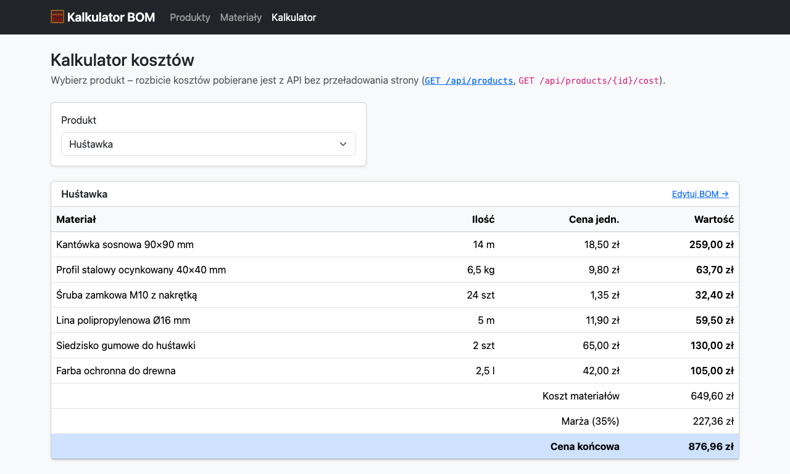
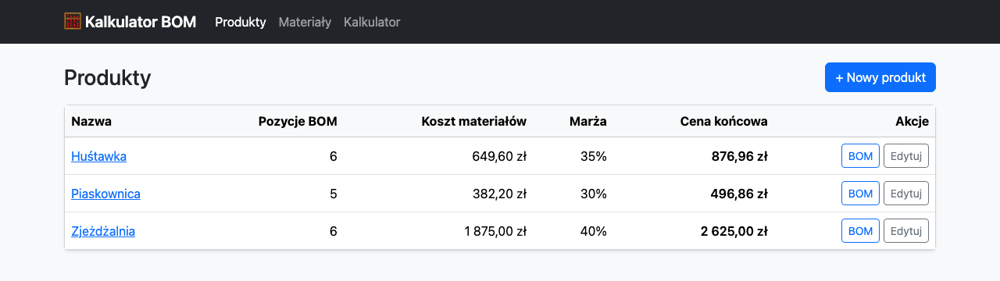
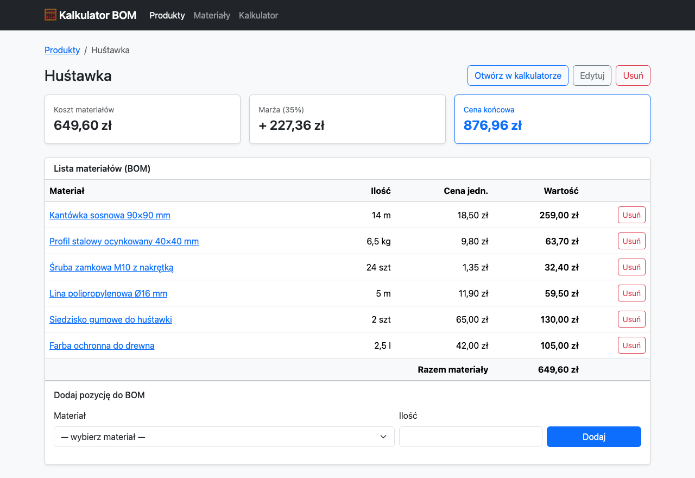

# Kalkulator kosztu produktu (BOM)

Aplikacja w Symfony 7 do wyliczania kosztu wytworzenia i ceny sprzedaży produktu
na podstawie jego **BOM** (_Bill of Materials_, czyli listy materiałów z ilościami).

Dla każdego produktu definiujesz materiały i ich zużycie. Aplikacja liczy koszt
materiałów, dolicza marżę i podaje cenę końcową w trzech miejscach: na stronie
produktu, w REST API i na stronie kalkulatora, która pobiera dane z API bez
przeładowania strony.



## Funkcje

- **CRUD materiałów i produktów**: wygenerowany przez `make:crud`, dopracowany
  pod Bootstrap 5, z polskim UI i komunikatami flash.
- **Zarządzanie BOM na stronie produktu**: dodawanie i usuwanie pozycji (materiał + ilość)
  z podsumowaniem kosztów na bieżąco.
- **Serwis `CostCalculator`**: cała logika kosztowa w jednym miejscu, bez kodu w kontrolerach.
- **REST API**: lista produktów i rozbicie kosztów produktu w JSON (Symfony Serializer).
- **Strona `/kalkulator`**: czysty JavaScript (`fetch`, bez frameworków) renderuje tabelę kosztów.
- **Walidacja**: nazwa wymagana, cena i ilość większe od zera, marża 0–999,99%,
  ten sam materiał tylko raz w BOM produktu.
- **Fixtures**: przykładowe produkty placu zabaw (Huśtawka, Zjeżdżalnia, Piaskownica).
- **Testy**: jednostkowe dla `CostCalculator` i funkcjonalne dla API.

## Technologie

| Obszar         | Technologia                                                       |
|----------------|-------------------------------------------------------------------|
| Backend        | PHP 8.2+ (rozwijane na 8.4), Symfony 7.4 LTS                      |
| Baza danych    | MySQL 8.4 w Dockerze (`docker-compose.yml`)                       |
| ORM            | Doctrine ORM 3 + Doctrine Migrations, DoctrineFixturesBundle      |
| Widoki         | Twig, Bootstrap 5.3 (CDN), Symfony Form + Validator               |
| API            | Symfony Serializer (grupy serializacji, DTO)                      |
| Frontend       | Vanilla JavaScript (ES modules, `fetch`, `<template>`)            |
| Testy          | PHPUnit 11, WebTestCase, DAMA DoctrineTestBundle                  |
| Jakość kodu    | PHP-CS-Fixer (`@PSR12` + `@Symfony`, `declare(strict_types=1)`)   |

## Kluczowe decyzje projektowe

- **Pieniądze bez floatów.** Kolumny `DECIMAL` są w PHP stringami, a obliczenia idą
  przez `bcmath`. API zwraca kwoty jako stringi (`"876.96"`), żeby klient nie tracił precyzji.
- **Model kosztów.** Koszt pozycji = ilość × cena jednostkowa, zaokrąglony do groszy
  (jak na fakturze). Marża liczona jest od kosztu materiałów (narzut):
  `cena końcowa = koszt materiałów + koszt materiałów × marża% / 100`.
- **Niemutowalny wynik.** `CostCalculator` zwraca DTO `CostBreakdown` / `CostLine`
  (`final readonly class`), serializowane wprost do JSON.
- **Bez N+1.** `ProductRepository::findWithBom()` i `findAllWithBom()` pobierają
  produkt, pozycje BOM i materiały jednym zapytaniem (fetch join).
- **Jednostki jako enum.** `App\Enum\Unit` (szt, m, m2, kg, l) mapowany przez Doctrine `enumType`.
- **Spójność danych.** Unikalny indeks (produkt, materiał) + `UniqueEntity`. Materiału
  użytego w BOM nie da się usunąć (czytelny komunikat zamiast błędu klucza obcego).
  Usunięcie produktu kasuje jego BOM (`ON DELETE CASCADE` + `orphanRemoval`).
- **Bezpieczny frontend.** JS wstawia dane przez `textContent` do szablonów `<template>`
  (bez `innerHTML`, czyli bez ryzyka XSS) i przerywa nieaktualne żądania przez `AbortController`.
- **Spójne błędy API.** Wyjątki HTTP pod `/api/` (404, 405) zwracane są jako JSON.

## Struktura katalogów

```
├── docker-compose.yml             # MySQL 8.4 (port 3309)
├── docker/mysql/init.sql          # zakłada bazę testową bom_calculator_test
├── migrations/                    # migracje Doctrine
├── public/js/calculator.js        # strona /kalkulator (fetch + render tabeli)
├── src/
│   ├── Controller/
│   │   ├── Api/ProductApiController.php
│   │   ├── CalculatorController.php
│   │   ├── MaterialController.php
│   │   └── ProductController.php  # CRUD produktu + zarządzanie BOM
│   ├── DataFixtures/AppFixtures.php
│   ├── Dto/                       # CostBreakdown, CostLine
│   ├── Entity/                    # Material, Product, BomItem
│   ├── Enum/Unit.php
│   ├── EventListener/ApiExceptionListener.php
│   ├── Form/                      # MaterialType, ProductType, BomItemType
│   ├── Repository/
│   ├── Service/CostCalculator.php
│   └── Twig/NumberFormatExtension.php   # filtry |pln i |decimal
├── templates/
└── tests/
    ├── Functional/Api/ProductApiTest.php
    └── Unit/Service/CostCalculatorTest.php
```

## Uruchomienie krok po kroku

### Wymagania

- PHP 8.2 lub nowszy z rozszerzeniami `pdo_mysql`, `bcmath`, `ctype`, `iconv`
- [Composer](https://getcomposer.org/) 2
- [Docker](https://www.docker.com/) z Docker Compose
- [Symfony CLI](https://symfony.com/download) (na macOS: `brew install symfony-cli/tap/symfony-cli`)

### Instalacja

1. **Sklonuj repozytorium i zainstaluj zależności**

   ```bash
   git clone <adres-repozytorium> bom-calculator
   cd bom-calculator
   composer install
   ```

2. **Uruchom bazę danych MySQL**

   ```bash
   docker compose up -d --wait
   ```

   MySQL nasłuchuje na porcie **3309** hosta (żeby nie kolidować z lokalnym MySQL
   na 3306). Dane dostępowe są w `.env` (`DATABASE_URL`). Inną konfigurację ustawisz
   w pliku `.env.local`, który nie trafia do repozytorium.

3. **Utwórz schemat bazy i załaduj przykładowe dane**

   ```bash
   php bin/console doctrine:migrations:migrate -n
   php bin/console doctrine:fixtures:load -n
   ```

4. **Uruchom serwer deweloperski**

   ```bash
   symfony serve -d
   ```

   Aplikacja będzie dostępna pod adresem wypisanym przez Symfony CLI, domyślnie
   http://127.0.0.1:8000. Jeśli port jest zajęty, użyj np. `symfony serve -d --port=8001`.
   Zamiast Symfony CLI możesz użyć wbudowanego serwera PHP: `php -S 127.0.0.1:8000 -t public`.

5. **Gotowe.** Najważniejsze adresy:

   | Strona                    | Adres                     |
   |---------------------------|---------------------------|
   | Produkty (strona główna)  | `/products`               |
   | Materiały                 | `/materials`              |
   | Kalkulator (fetch + API)  | `/kalkulator`             |
   | API: lista produktów      | `/api/products`           |
   | API: koszt produktu       | `/api/products/1/cost`    |

### Testy

Baza testowa `bom_calculator_test` powstaje automatycznie przy pierwszym starcie
kontenera (`docker/mysql/init.sql`). Przed pierwszym uruchomieniem testów utwórz w niej schemat:

```bash
php bin/console --env=test doctrine:migrations:migrate -n
```

Uruchomienie testów:

```bash
composer test          # lub: php bin/phpunit
```

Każdy test funkcjonalny działa w transakcji wycofywanej po teście (DAMA DoctrineTestBundle),
więc baza testowa zostaje czysta.

### Styl kodu

```bash
composer cs            # sprawdzenie (PSR-12 + Symfony)
composer cs:fix        # automatyczna poprawa
```

## REST API

| Metoda | Endpoint                    | Opis                                    | Kody        |
|--------|-----------------------------|-----------------------------------------|-------------|
| GET    | `/api/products`             | Lista produktów (sortowana po nazwie)   | 200         |
| GET    | `/api/products/{id}/cost`   | Rozbicie kosztów produktu               | 200, 404    |

### `GET /api/products`

```bash
curl http://127.0.0.1:8000/api/products
```

```json
[
    {"id": 1, "name": "Huśtawka", "marginPercent": "35.00"},
    {"id": 3, "name": "Piaskownica", "marginPercent": "30.00"},
    {"id": 2, "name": "Zjeżdżalnia", "marginPercent": "40.00"}
]
```

### `GET /api/products/{id}/cost`

```bash
curl http://127.0.0.1:8000/api/products/1/cost
```

Odpowiedź `200 OK` (lista `items` skrócona do 2 z 6 pozycji):

```json
{
    "productId": 1,
    "productName": "Huśtawka",
    "items": [
        {
            "bomItemId": 1,
            "materialId": 1,
            "materialName": "Kantówka sosnowa 90×90 mm",
            "unit": "m",
            "quantity": "14.000",
            "unitPrice": "18.50",
            "totalCost": "259.00"
        },
        {
            "bomItemId": 6,
            "materialId": 6,
            "materialName": "Farba ochronna do drewna",
            "unit": "l",
            "quantity": "2.500",
            "unitPrice": "42.00",
            "totalCost": "105.00"
        }
    ],
    "materialsCost": "649.60",
    "marginPercent": "35.00",
    "marginAmount": "227.36",
    "finalPrice": "876.96",
    "currency": "PLN"
}
```

Gdy produkt nie istnieje, odpowiedź to `404 Not Found`:

```json
{"error": "Produkt o id 999 nie istnieje."}
```

## Zrzuty ekranu

**Lista produktów** z kosztem materiałów i ceną końcową:



**Karta produktu**: BOM, podsumowanie kosztów i dodawanie pozycji:



## Możliwe kierunki rozwoju

- Statyczna analiza (PHPStan) i CI (GitHub Actions) uruchamiające testy i CS.
- Uwierzytelnianie (Symfony Security) i role, np. tylko odczyt dla handlowców.
- Historia cen materiałów i kalkulacje „na dzień”.
- Edycja ilości istniejącej pozycji BOM bez jej usuwania.
